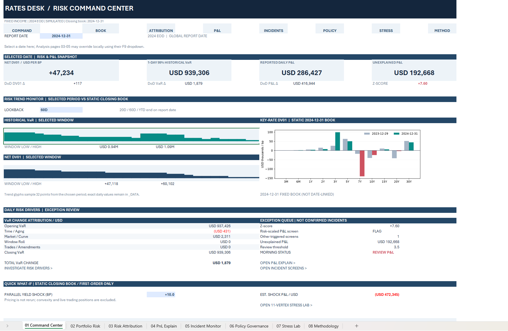
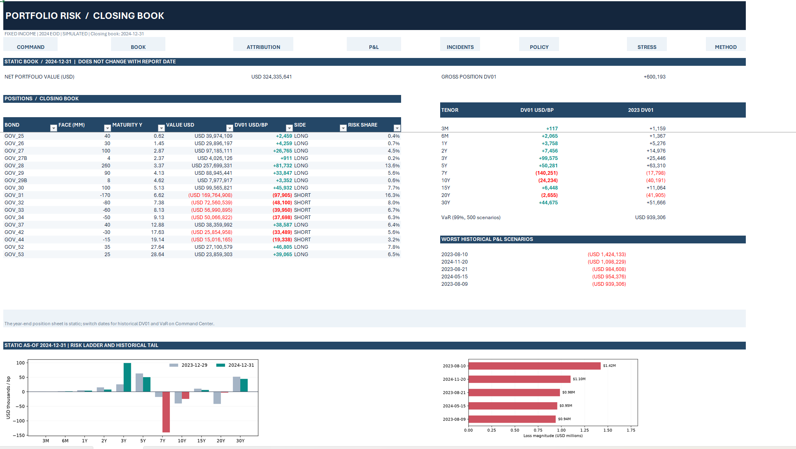
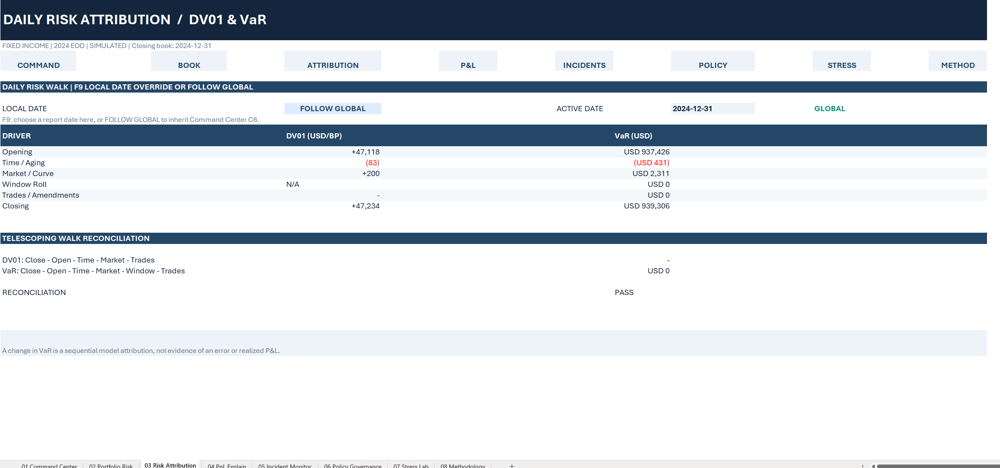
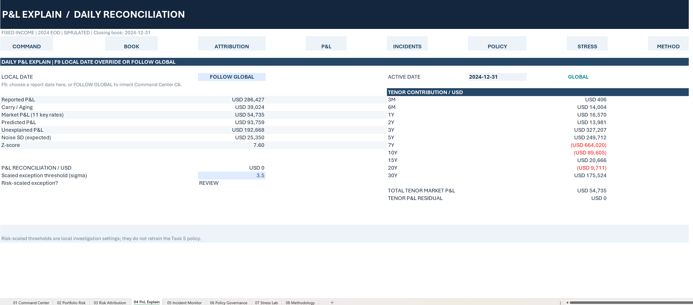
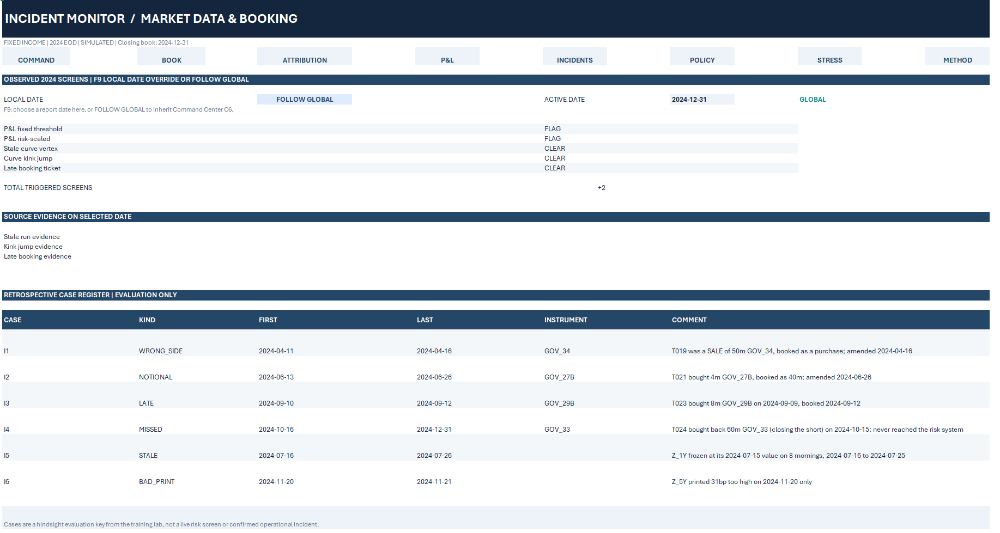
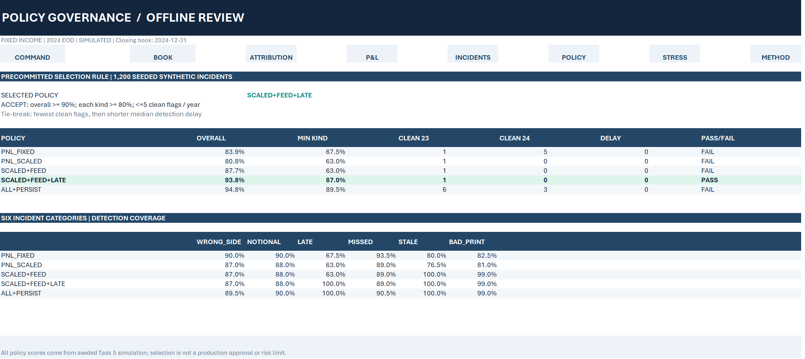
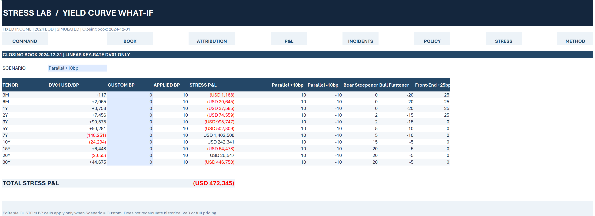
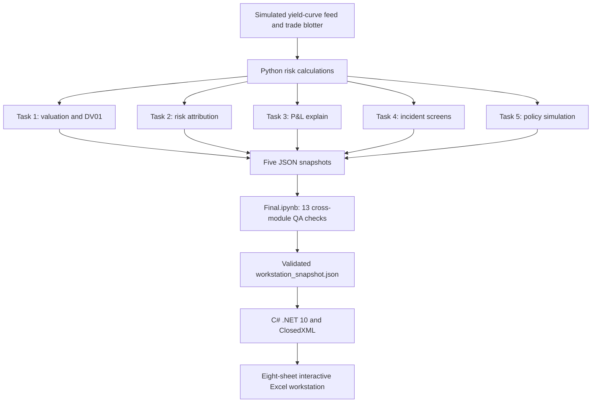

# Fixed Income Risk Workstation

**A simulated rates-desk risk analytics and reporting application built with Python, C#/.NET 10, ClosedXML and Microsoft Excel.**

[View the final integration notebook](Final.ipynb) · [Run instructions](RUN_FINAL.md) · [Integration validation](INTEGRATION_VALIDATION.md)

> **The business problem:** A desk's closing risk number is not enough. Traders and risk analysts also need to understand *what changed*, *why P&L differs from model expectations*, *which anomalies require investigation*, and *whether the monitoring policy is effective*.
>
> 
> This is an **educational simulation**, not a live trading system. Positions, prices, incidents and approvals shown here are not real desk activity.

## The workstation

The final deliverable is a **macro-free, interactive, eight-sheet Excel workstation** produced by a C# reporting application. The underlying risk calculations and controls are implemented in five Python modules and reconciled in `Final.ipynb`.

### 01 · Rates Desk Command Center

[](docs/screenshots/01_command_center.png)

*2024-12-31 simulated end-of-day view. Select a global reporting date, investigate risk/P&L changes, compare 20D / 60D / YTD trends, and run a first-order parallel yield shock against the fixed closing book. Click the image to enlarge.*

### Closing-book and evaluation snapshot

| Metric | Result | Scope |
|:--|--:|:--|
| Net portfolio marked value | **USD 324.34M** | Closing positions, 2024-12-31 |
| Live bond positions | **17** | Closing book, 2024-12-31 |
| Net Key-Rate DV01 | **+47,234 USD/bp** | Closing book, 2024-12-31 |
| Gross position DV01 | **600,193 USD/bp** | Sum of absolute bond-position DV01 |
| 1-day 99% Historical Simulation VaR | **USD 939,306** | 500 historical curve scenarios |
| Daily reported / unexplained P&L | **USD 286,427 / USD 192,668** | 2024-12-31; unexplained Z-score **+7.60** |
| Historical reporting period | **260 trading days** | Date-linked risk, P&L and screens for 2024 |
| Offline policy detection rate | **93.8%** | Selected policy; 1,200 simulated incidents |

**Important distinction:** The historical risk/P&L screens respond to the selected date. The portfolio holdings, 11-tenor closing-book chart and Stress Lab are **fixed at 2024-12-31**. The policy selection is an **offline simulation result**, not an approved live limit or operational sign-off.

## Explore all seven Excel views

The following are **actual screenshots** of the C#-generated workbook. Click an image to inspect the full-size worksheet.

| 02 · Portfolio Risk | 03 · Risk Attribution |
|:--|:--|
| [](docs/screenshots/02_portfolio_risk.png) | [](docs/screenshots/03_risk_attribution.png) |
| **Static closing-book view:** bond-level long/short exposures, 11 Key-Rate DV01 vertices, historical tail losses. | **Daily walk:** time/aging, market, historical-window roll and trade effects; date override and reconciliation. |

| 04 · P&L Explain | 05 · Incident Monitor |
|:--|:--|
| [](docs/screenshots/04_pnl_explain.png) | [](docs/screenshots/05_incident_monitor.png) |
| **Daily P&L reconciliation:** carry, rate-driven market P&L, unexplained P&L, tenor contributions and Z-score. | **Investigation view:** five observed screening signals, source evidence and six separately labeled retrospective cases. |

| 06 · Policy Governance | 07 · Yield Curve Stress Lab |
|:--|:--|
| [](docs/screenshots/06_policy_governance.png) | [](docs/screenshots/07_stress_lab.png) |
| **Offline policy review:** detection coverage, clean-day false flags and a precommitted acceptance rule over 1,200 trials. | **What-if analysis:** parallel, steepener/flattener and custom tenor shocks; first-order stressed P&L for the static closing book. |

*The eighth worksheet, `08 Methodology`, records model conventions, evidence boundaries and cross-module validation checks.*

## What makes the application interactive?

| User action | Where | What updates |
|:--|:--|:--|
| Select global report date | `01 Command Center!C6` | Command Center risk, P&L, screen metrics and date-linked analysis views |
| Select `20D`, `60D`, or `YTD` | `01 Command Center!C20` | Historical VaR/DV01 trend monitors and window extrema |
| Use local date override | Sheets **03–05**, cell `F9` | Only that analysis page; `FOLLOW GLOBAL` restores the shared default |
| Change daily exception threshold | `04 PnL Explain` | Local investigation flag; **does not** retrain the Task 5 policy |
| Enter a parallel yield shock | `01 Command Center` | Quick first-order stress P&L for the **static** 2024-12-31 closing book |
| Select or customize a curve scenario | `07 Stress Lab` | Applied shocks and 11-tenor stress contributions |
| Follow internal navigation links | Workbook header and review sections | Jump directly to the relevant analysis or investigation worksheet |

The workbook uses **Excel formulas, validation dropdowns and hyperlinks — no embedded VBA**. The trend monitors are formula-driven, sampled visual summaries; the full 2024 daily series remains in the hidden data sheets. The 11-tenor closing-book chart is a static report graphic, not a date-linked historical book reconstruction.

## Risk analytics modules

| Module | What it answers | Notebook and details |
|:--|:--|:--|
| **Task 1 — Daily Risk Report** | What is the book worth and where is its rate sensitivity? | [Notebook](Task1_Daily_Report/daily_report.ipynb) · [Documentation](Task1_Daily_Report/TASK1_GITHUB_README.md) |
| **Task 2 — Risk Walk** | Why did DV01 and Historical VaR change? | [Notebook](Task2_Risk_Walk/risk_walk.ipynb) · [Documentation](Task2_Risk_Walk/TASK2_GITHUB_README.md) |
| **Task 3 — P&L Explain** | How much daily P&L can carry and market moves explain? | [Notebook](Task3_Pnl_Explain/pnl_explain.ipynb) · [Documentation](Task3_Pnl_Explain/TASK3_GITHUB_README.md) |
| **Task 4 — Incident Forensics** | Which feed or booking anomalies should be investigated? | [Notebook](Task4_Incident_forensics/incident_forensics.ipynb) · [Documentation](Task4_Incident_forensics/TASK4_GITHUB_README.md) |
| **Task 5 — Policy Review** | Which combination of screens balances detection and false alerts? | [Notebook](Task5_Review_Policy/review_policy.ipynb) · [Documentation](Task5_Review_Policy/TASK5_GITHUB_README.md) |

### Core methodologies

**Bond valuation and Key-Rate DV01.** Semiannual cash flows are discounted with interpolated, continuously compounded zero-coupon yields. Each bond's rate sensitivity is allocated across **11 curve vertices (3M–30Y)**.

**Historical Simulation VaR.** For each of 500 daily historical curve changes, the engine estimates portfolio scenario P&L using the Key-Rate DV01 ladder. The model's 1-day 99% VaR is the negative of the **fifth-worst** scenario P&L.

**Daily risk attribution.** Task 2 builds sequential DV01 and VaR states to separate **Time/Aging, Market/Curve, Historical Window Roll and Trades/Amendments**. Arithmetic reconciliation tests the resulting walk.

**P&L explanation.** Task 3 separates carry, modeled market P&L and unexplained residual, then scales residuals using a noise model calibrated on **2023** observations. The dashboard's investigation threshold does not establish an operational breach.

**Incident screening and policy evaluation.** Task 4 tests fixed/scaled P&L, stale-feed, curve-kink and late-booking signals against six *retrospectively known* synthetic cases. Task 5 compares five predefined policies using **1,200 seeded synthetic incident trials (200 of each of six types)**.

The selected *offline* policy, `SCALED+FEED+LATE`, reached **93.8%** overall detection with **1 combined clean-day flag** across 2023 and 2024. Its acceptance criteria were established before selecting a winner: at least 90% overall detection, 80% per incident kind, and no more than five clean flags in each year. A higher detection rate alone is **not** sufficient to pass the policy rule.

## System architecture



The separation is intentional: **Python calculates**, the **final notebook integrates and validates**, and **C# presents the results in Excel**. Workbook-specific interactions use Excel formulas on exported and validated data, not an embedded duplicate pricing engine.

## Repository layout

```text
RDA Risk test/
├── Task1_Daily_Report/
│   ├── daily_report.ipynb
│   └── TASK1_GITHUB_README.md
├── Task2_Risk_Walk/
│   ├── risk_walk.ipynb
│   └── TASK2_GITHUB_README.md
├── Task3_Pnl_Explain/
│   ├── pnl_explain.ipynb
│   └── TASK3_GITHUB_README.md
├── Task4_Incident_forensics/
│   ├── incident_forensics.ipynb
│   └── TASK4_GITHUB_README.md
├── Task5_Review_Policy/
│   ├── review_policy.ipynb
│   └── TASK5_GITHUB_README.md
├── Excel_Template_Design/
│   ├── DeskRiskExcel_V3.cs
│   ├── DeskRiskAttribution_Task2_V2.cs
│   ├── DeskRiskPnL_Task3.cs
│   ├── DeskRiskForensics_Task4.cs
│   ├── DeskRiskPolicy_Task5.cs
│   └── DeskRiskWorkstation_Final.cs
├── docs/screenshots/
│   ├── 01_command_center.png
│   ├── 02_portfolio_risk.png
│   ├── 03_risk_attribution.png
│   ├── 04_pnl_explain.png
│   ├── 05_incident_monitor.png
│   ├── 06_policy_governance.png
│   └── 07_stress_lab.png
├── DataSource/                   # locally supplied, Git-ignored
├── Excel_Template_Output/        # generated artifacts, Git-ignored
├── Final.ipynb                    # validated integration entry point
├── INTEGRATION_VALIDATION.md
├── RUN_FINAL.md
├── README.md
└── .gitignore
```

The directory displayed above matches the **local project structure**; GitHub's repository name can differ from the folder name. Source files and the seven screenshot PNGs are tracked; model-generated JSON/Excel and the exercise feed are intentionally excluded.

## How to run locally

**Prerequisites**

- Windows with Microsoft Excel for the generated workbook.
- Python with Jupyter, NumPy, pandas and Matplotlib.
- **.NET 10 SDK**, including support for single-file C# applications; first build may restore `ClosedXML@0.105.1` from NuGet.
- An **authorized copy** of the exercise feed, placed at `DataSource/rates_desk_feed.csv`.

**Build workflow**

1. Run the five notebook calculation/export pipelines to produce `task1_snapshot.json` through `task5_snapshot.json` inside `Excel_Template_Output/`.
2. Open [Final.ipynb](Final.ipynb) from the project root and run all cells. It checks the cross-module contract and produces `workstation_snapshot.json`.
3. Generate the Excel workbook by running the C# cell in `Final.ipynb`, or run this command in PowerShell from the project root:

   ```powershell
   dotnet run --file .\Excel_Template_Design\DeskRiskWorkstation_Final.cs
   ```

4. Open `Excel_Template_Output/RatesDesk_RiskWorkstation_FINAL_2024-12-31.xlsx` in desktop Excel, and use the global/local date controls or Stress Lab.

The reporting code reads the project root from the working directory or the optional `RAD_RISK_ROOT` environment variable. Consult [RUN_FINAL.md](RUN_FINAL.md) for Windows setup and troubleshooting.

**Dataset availability:** The training CSV and the generated JSON/Excel outputs are not committed, so this repository is **not fully runnable from a clean clone without access to the exercise feed**. The included notebooks, validations, source code and screenshots document the implementation and its observed output.

## Validation, assumptions and limitations

- **13 integration QA gates** check data-contract consistency, dates, risk/P&L reconciliation and the selected offline policy; results are documented in [INTEGRATION_VALIDATION.md](INTEGRATION_VALIDATION.md).
- Reconciliation `PASS` means that the model's arithmetic identities hold, **not** that market data, model assumptions or trade records are independently certified.
- Task 4's known incident log, corrected feed and adjusted VaR are **retrospective evidence**, never live labels used by the observed screening rules.
- Task 5's selected policy is based on **seeded simulation**, not live deployment, approval or guaranteed out-of-sample performance.
- The portfolio model covers fixed-rate government bonds with first-order interest-rate sensitivities. It does **not** model convexity under large shocks, credit spread, liquidity, funding costs, transaction costs or live trading/execution.
- The workbook is a **historical end-of-day tool**. It does not refresh live quotes, place orders or enforce actual risk limits.

## Attribution

The starting educational exercise is [RiskHub — Fixed Income Risk Dashboard Python Lab](https://riskhub.org/python-labs/fixed-income-risk-dashboard). The five-stage notebooks, reporting integration, C# Excel workbooks, UI interactions, QA documentation and portfolio presentation are extensions to that exercise. Source data and other materials are subject to the original provider's usage and redistribution terms; review them before publishing copies.

---

**Portfolio focus:** fixed-income risk concepts · numerical Python · C# application development · spreadsheet UX · reconciled data pipelines · investigation workflows.
